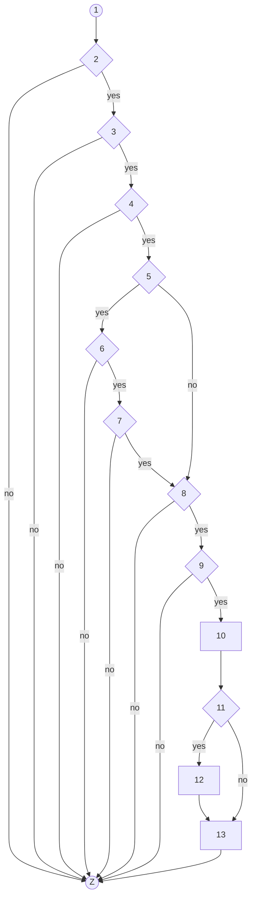
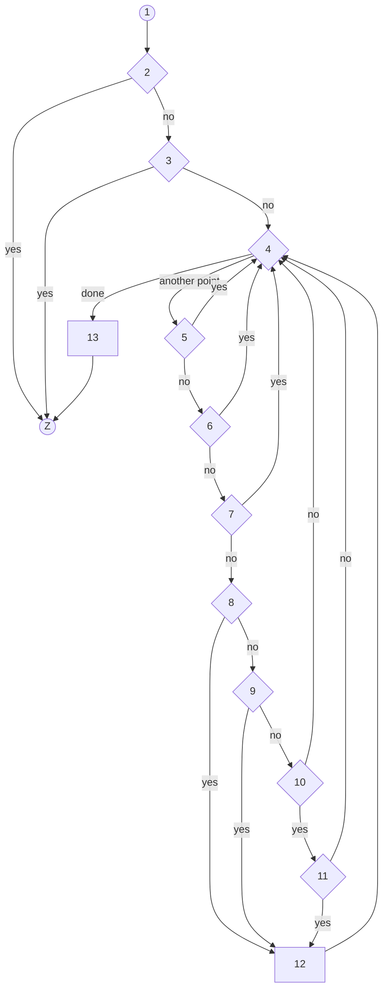

# Basis-path (white-box) tests (task Q2, Lab 4 manual 3.2.2 to 3.2.4)

Two methods with real branching were chosen:

1. `TripService.updatePickupStatus` (D1): the driver's PICKED_UP / DROPPED_OFF / NO_SHOW buttons (FR 6.5 to 6.8). The task file says "TrackingService"; the method lives in `TripService`.
2. The **match filter chain**, `fitJourney` and the `bestPickup` loop inside it, in `server/src/services/matching.ts` (B5b; FR 4.2, 4.7). The free-seat and not-LOCKED filters (FR 4.9) are database conditions of the search query, not branches, so they are tested in `matching.int.test.ts`.

Cyclomatic complexity is computed as **V(G) = E - N + 2** on a graph with one exit node `Z` (every `return` or `throw` goes to `Z`), and cross-checked as **decision nodes + 1**.

---

## 1. `TripService.updatePickupStatus`

| Node | What it is                                                |
| ---- | --------------------------------------------------------- |
| 1    | start: read the booking                                   |
| 2    | **D** booking found?                                      |
| 3    | **D** caller is the journey's driver?                     |
| 4    | **D** journey is IN_PROGRESS?                             |
| 5    | **D** the new status is NO_SHOW?                          |
| 6    | **D** the rider is ARRIVED?                               |
| 7    | **D** 3 minutes have passed since ARRIVED (by the Clock)? |
| 8    | **D** the booking is CONFIRMED?                           |
| 9    | **D** the state machine allows this move?                 |
| 10   | write the new pickup status                               |
| 11   | **D** the new status is NO_SHOW (second test)?            |
| 12   | release the hold, free the seat, re-tier the others       |
| 13   | publish `PickupStatusChanged`, return the booking         |
| Z    | exit (return or throw)                                    |



**Nodes N = 14, edges E = 22, so V(G) = 22 - 14 + 2 = 10.** Nine decision nodes (2, 3, 4, 5, 6, 7, 8, 9, 11) + 1 = 10. A basis set therefore has 10 paths.

| Path          | Nodes on the path                            | Test input                          | Expected output                                  | Feasible?           |
| ------------- | -------------------------------------------- | ----------------------------------- | ------------------------------------------------ | ------------------- |
| P1            | 1, 2, Z                                      | booking id that does not exist      | `NOT_FOUND`                                      | yes                 |
| P2            | 1, 2, 3, Z                                   | another driver presses a button     | `FORBIDDEN`                                      | yes                 |
| P3            | 1, 2, 3, 4, Z                                | journey is OPEN, not started        | `ILLEGAL_STATE_TRANSITION`                       | yes                 |
| P4            | 1, 2, 3, 4, 5, 6, Z                          | NO_SHOW while the rider is WAITING  | `ILLEGAL_STATE_TRANSITION`                       | yes                 |
| P5            | 1, 2, 3, 4, 5, 6, 7, Z                       | NO_SHOW 2:59 after ARRIVED          | `ILLEGAL_STATE_TRANSITION`, status stays ARRIVED | yes                 |
| P6            | 1, 2, 3, 4, 5, 8, Z                          | PICKED_UP on a CANCELLED booking    | `ILLEGAL_STATE_TRANSITION`                       | yes                 |
| P7            | 1, 2, 3, 4, 5, 8, 9, Z                       | DROPPED_OFF while WAITING           | `ILLEGAL_STATE_TRANSITION`, status stays WAITING | yes                 |
| P8 (baseline) | 1, 2, 3, 4, 5, 8, 9, 10, 11, 13, Z           | PICKED_UP while WAITING             | booking is PICKED_UP, one event, hold untouched  | yes                 |
| P9            | 1, 2, 3, 4, 5, 6, 7, 8, 9, 10, 11, 12, 13, Z | NO_SHOW exactly 3:00 after ARRIVED  | NO_SHOW, hold released, seat back                | yes                 |
| P10           | 1, 2, 3, 4, 5, 8, 9, 10, 11, 12, 13, Z       | needs node 5 false and node 11 true | none: node 11 repeats node 5's condition         | **no** (infeasible) |

Result: **9 feasible independent paths, 9 tests** (`server/src/services/TripService.paths.test.ts`). P10 is documented and has no test because no input can reach it.

---

## 2. The match filter chain: `fitJourney` with `bestPickup`

| Node | What it is                                                                          |
| ---- | ----------------------------------------------------------------------------------- |
| 1    | start                                                                               |
| 2    | **D1** the stored route has no points?                                              |
| 3    | **D2** the rider's destination is off the driver's way (detour over the tolerance)? |
| 4    | **D3** loop: is there another pickup point to look at?                              |
| 5    | **D4** the pickup type is not allowed by the preset?                                |
| 6    | **D5** walking distance over 400 m?                                                 |
| 7    | **D6** detour over the tolerance (never above 5 min)?                               |
| 8    | **D7** nothing chosen yet?                                                          |
| 9    | **D8** detour smaller than the best so far?                                         |
| 10   | **D9** detour equal to the best so far?                                             |
| 11   | **D10** walking distance shorter than the best so far?                              |
| 12   | this point becomes the best                                                         |
| 13   | return the best (or none)                                                           |
| Z    | exit                                                                                |



**N = 14, E = 23, so V(G) = 23 - 14 + 2 = 11.** Ten decision nodes (2 to 11) + 1 = 11.

| Path | Nodes on the path                                 | Test input                                   | Expected output |
| ---- | ------------------------------------------------- | -------------------------------------------- | --------------- |
| P1   | 1, 2, Z                                           | route with no points                         | none            |
| P2   | 1, 2, 3, Z                                        | destination 900 m off the route (5.4 min)    | none            |
| P3   | 1, 2, 3, 4, 13, Z                                 | the place has no pickup points               | none            |
| P4   | 1, 2, 3, 4, 5, 4, 13, Z                           | one CARPARK, the driver allows only BUS_STOP | none            |
| P5   | 1, 2, 3, 4, 5, 6, 4, 13, Z                        | one stop 401 m on foot                       | none            |
| P6   | 1, 2, 3, 4, 5, 6, 7, 4, 13, Z                     | one stop 900 m off the route (5.4 min)       | none            |
| P7   | 1, 2, 3, 4, 5, 6, 7, 8, 12, 4, 13, Z              | one acceptable stop                          | that stop       |
| P8   | ... 8, 12, 4, 5, 6, 7, 8, 9, 12, 4, 13, Z         | far stop then a nearer one                   | the nearer stop |
| P9   | ... 8, 12, 4, 5, 6, 7, 8, 9, 10, 4, 13, Z         | near stop then a farther one                 | the near stop   |
| P10  | ... 8, 12, 4, 5, 6, 7, 8, 9, 10, 11, 12, 4, 13, Z | same detour, second walk is shorter          | the second stop |
| P11  | ... 8, 12, 4, 5, 6, 7, 8, 9, 10, 11, 4, 13, Z     | same detour, second walk is longer           | the first stop  |

Result: **11 feasible paths, 11 tests**, plus the two boundary tests inside nodes 7 and 6 (detour exactly 5.0 minutes accepted and 5.1 refused; 400 m accepted and 401 m refused) in `server/src/services/matching.paths.test.ts`.

---

## Actual output (a real run on 19 Oct 2026)

`npx vitest run --project server-db server/src/services/` : **2 files, 22 tests passed** (9 paths of method 1, 11 paths and 2 boundaries of method 2).

## Each path test can fail (the manual asks for this)

A condition was changed in the code, the two files were run, and the code was put back:

| Change made                                                        | Test that failed                   | Others    |
| ------------------------------------------------------------------ | ---------------------------------- | --------- |
| removed the 3-minute wait check in `TripService.applyPickupStatus` | P5 (method 1)                      | 21 passed |
| `walkDistanceM > MAX_WALK_M` changed to `>=` in `bestPickup`       | the 400 m boundary test (method 2) | 21 passed |
| removed the "pickup type allowed" check in `bestPickup`            | P4 (method 2)                      | 21 passed |

After restoring the code: 22 of 22 pass.

## How to rerun

```
docker compose up -d        # the paths files use the database project
npx vitest run --project server-db server/src/services/TripService.paths.test.ts server/src/services/matching.paths.test.ts
```
